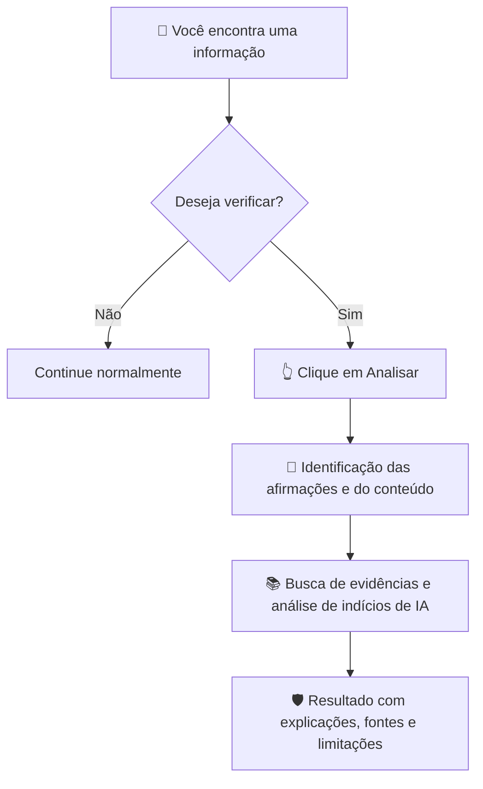

# 🛡️ AutenticAI

### Proteção real, a qualquer hora, em qualquer lugar, contra fake news.

**A informação chega até você. A verificação também deveria chegar.**

**Verificação de fatos · Investigação de fontes · Indícios de conteúdo gerado por IA**

---

## 💭 Você já se perguntou...

> **Essa notícia é verdadeira?**  
> **Essa imagem é autêntica?**  
> **Esse texto pode ter sido criado por inteligência artificial?**  
> **De onde veio essa informação?**

Todos os dias, encontramos conteúdos que parecem convincentes, mas nem sempre têm fontes confiáveis. Em meio a notícias, mensagens, publicações e vídeos, distinguir informação de desinformação pode exigir tempo e pesquisa.

O **AutenticAI** nasce com uma proposta simples: **tornar a verificação mais acessível, diretamente nos lugares onde as pessoas consomem conteúdo.**

## ✨ O que é o AutenticAI?

O **AutenticAI** é um projeto de plataforma integrada para **verificar afirmações, consultar evidências e identificar sinais de conteúdos produzidos ou alterados por inteligência artificial**.

Em vez de depender apenas de copiar um conteúdo e procurar um site externo, a proposta reúne **site web, extensão para Google Chrome e aplicativo Android** em uma mesma experiência.

**A ideia não é decidir o que você deve acreditar. É ajudar você a avaliar melhor o que está vendo.**

## 🌐 Uma solução, três formas de usar

| Plataforma | Onde você usa | Como será a experiência |
|:--|:--|:--|
| **🌍 Site web** | No navegador, em qualquer dispositivo compatível | Envie ou cole um texto, notícia ou link para solicitar uma análise detalhada. |
| **🧩 Extensão Chrome** | Enquanto navega na internet | Clique em **“Analisar página”** para verificar o conteúdo da página atual, sem precisar copiá-lo manualmente. |
| **📱 Aplicativo Android** | No celular, inclusive ao consultar conteúdo em outros apps | Com a permissão necessária, toque em **“Analisar tela”** para analisar o que está visível naquele momento. |

> **Nosso princípio:** a proteção deve estar ao alcance do usuário onde ele estiver, **sem realizar verificações contínuas em segundo plano**.

## 👆 Um clique para analisar

O AutenticAI foi pensado para funcionar **sob demanda**: **você escolhe quando quer verificar um conteúdo**.

**Por que isso importa?**

- **Mais controle:** a análise é iniciada por uma decisão sua.
- **Menos interrupções:** não há notificações ou varreduras constantes por padrão.
- **Uso mais responsável dos recursos:** evita requisições desnecessárias e ajuda a manter o custo do serviço viável.
- **Mais privacidade:** o objetivo é solicitar somente os dados necessários para a verificação, com informações claras sobre o que será processado.

## 🔍 O que uma análise pretende mostrar?

O resultado será organizado em **dois eixos independentes**, para não confundir autenticidade de autoria com veracidade da informação.

| 🔎 Verificação de fatos | 🤖 Análise de IA |
|:--|:--|
| Identificação das afirmações que podem ser checadas. | Identificação de indícios de conteúdo sintético ou manipulado. |
| Consulta a fontes e evidências relevantes. | Exibição de uma **estimativa de detecção**, quando tecnicamente aplicável. |
| Classificação contextual: **sustentado, contradito ou inconclusivo**. | Explicação dos sinais observados e das limitações da ferramenta. |
| Links para o usuário conferir as referências. | Destaque para a **incerteza** do resultado. |

> [!IMPORTANT]
> **Uma porcentagem de IA não é uma prova de autoria.** Ela representa o resultado estimado de um método de detecção e pode conter erros. Da mesma forma, **um conteúdo criado por IA pode apresentar informações corretas**, e uma publicação escrita por uma pessoa pode ser falsa.

### 🧾 Exemplo ilustrativo de resultado

> **Verificação de afirmações**  
> ✅ 3 afirmações sustentadas por fontes  
> ⚠️ 1 afirmação contradita por evidências  
> ❔ 1 afirmação sem elementos suficientes para uma conclusão  
>
> **Análise de IA**  
> 🤖 Indicador de detecção: **82%** *(valor fictício, não equivale a “82% do texto escrito por IA”)*  
>
> **Transparência**  
> 🔗 Fontes consultadas e justificativas acessíveis para revisão.

*Este exemplo representa o formato desejado para o produto, não uma verificação real ou uma demonstração de precisão.*

## 🚀 O que torna o AutenticAI diferente?

**Não queremos ser apenas mais uma página que recebe textos para análise.** Queremos levar a possibilidade de verificar informações para o contexto em que elas aparecem.

| Princípio | Nosso compromisso de projeto |
|:--|:--|
| **Presença** | Experiência integrada entre web, navegador e celular. |
| **Simplicidade** | Um botão para solicitar uma análise, com linguagem clara. |
| **Contexto** | Verificar informações sem depender sempre de copiar e colar. |
| **Transparência** | Mostrar evidências, referências, limites e incertezas. |
| **Privacidade** | Ativação voluntária e permissões explícitas para acessar conteúdos. |
| **Sustentabilidade** | Evitar análises automáticas contínuas que gerem custos desnecessários. |

## 🔐 Você controla quando a análise acontece

A proteção do AutenticAI **não significa observar a tela o tempo todo**.

- A extensão e o aplicativo devem iniciar a verificação **somente quando o usuário acionar o botão de análise**.
- O acesso à página ou à tela deve respeitar as **permissões da plataforma** e a autorização do usuário.
- O projeto deve priorizar o envio da **menor quantidade de informação necessária**, evitando a coleta de conteúdos privados sem necessidade.
- A captura e a análise de telas no Android dependem das permissões e restrições do sistema operacional; nem todo conteúdo poderá ser acessado.

**Proteção disponível a qualquer hora não é vigilância permanente.**

## 🧭 Visão de desenvolvimento

O objetivo de longo prazo é oferecer análises de **textos, notícias, links, imagens, vídeos e outros conteúdos digitais**. Para construir isso de forma viável, a evolução foi dividida em etapas.

| Etapa | Prioridade | Entregas planejadas |
|:--|:--:|:--|
| **1. Plataforma web** | Alta | Análise de textos e links, consulta de fontes e relatório explicativo. |
| **2. Extensão Chrome** | Alta | Botão **“Analisar página”** integrado ao sistema de verificação. |
| **3. Aplicativo Android** | Alta | Botão **“Analisar tela”**, com autorização de captura e análise sob demanda. |
| **4. Novos formatos** | Evolutiva | Ampliação e aprimoramento da análise de imagens, vídeos e conteúdos manipulados. |
| **5. Experiência integrada** | Evolutiva | Histórico e preferências sincronizados, se o usuário optar por utilizá-los. |

## ❓ Perguntas frequentes

<strong>O AutenticAI vai monitorar tudo o que eu faço?</strong>

Não é essa a proposta. Na extensão e no aplicativo, a análise será solicitada por um botão. O projeto não prevê verificações contínuas em segundo plano.

<strong>Ele vai afirmar com certeza que uma notícia é falsa?</strong>

Não necessariamente. Algumas afirmações poderão ser sustentadas ou contraditas pelas fontes encontradas; outras continuarão inconclusivas. A ideia é mostrar os motivos e as referências, em vez de oferecer um julgamento sem explicação.

<strong>Ele consegue saber exatamente quanto de um texto foi escrito por IA?</strong>

Não. Detectores podem gerar pontuações, mas elas não representam uma medição exata da porcentagem escrita por IA. Esses resultados precisam ser apresentados com cautela, pois podem ocorrer erros de classificação.

<strong>Vai funcionar em qualquer aplicativo Android?</strong>

Essa é a direção da proposta, mas a compatibilidade dependerá das permissões de captura e das restrições de cada aplicativo e versão do Android. Algumas telas ou conteúdos protegidos podem não ser capturáveis.

<strong>Por que a análise não será automática o tempo todo?</strong>

Porque nem todo conteúdo precisa ser verificado. O acionamento manual dá mais controle ao usuário e reduz solicitações desnecessárias, custos de processamento e tratamento de dados.

## 📍 Situação do projeto

> **Em planejamento.** Este documento apresenta a **proposta e a visão do AutenticAI**. Os recursos descritos são **objetivos de desenvolvimento**, não funcionalidades já lançadas ou garantias de desempenho.

A missão é construir uma tecnologia que torne a verificação de informações **mais prática, acessível, transparente e integrada à vida digital**.

---

### 🛡️ AutenticAI

**Questione o que recebe. Confira as evidências. Decida com mais informação.**

*Proteção real, a qualquer hora, em qualquer lugar, contra fake news — ao alcance de um clique.*

