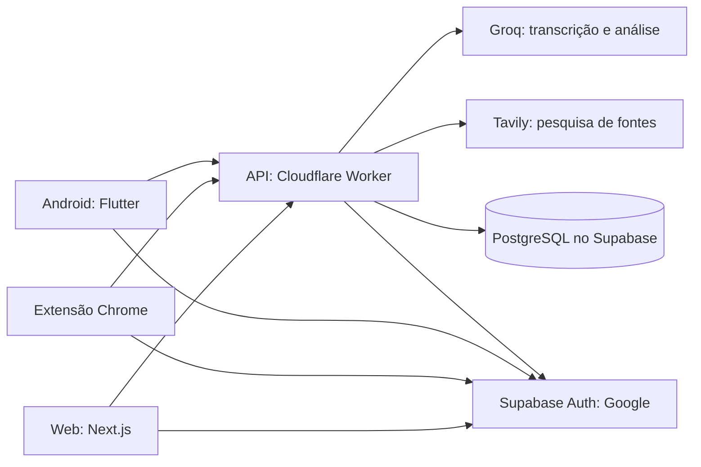

# Arquitetura — AutenticAI

## Objetivo e escopo

O AutenticAI é um projeto acadêmico de análise de informações. A API e a migração do banco estão em `system/backend/`. O projeto remoto do Supabase já tem o esquema inicial do histórico. Os clientes usam Supabase Auth com PKCE e enviam o token de acesso ao Worker. A extensão usa `activeTab` para ler o texto após solicitação. O Android usa `MediaProjection` para a captura iniciada pelo botão flutuante. [Guia do backend](../system/backend/README.md)

A web Next.js é exportada como arquivos estáticos e servida por um Worker. O Worker da API valida a sessão, chama Groq e Tavily e grava o relatório no Supabase. As duas chaves de API ficam no Worker. [Publicação da web](../system/web/README.md#publicação-no-cloudflare) · [Publicação da API](../system/backend/README.md#publicação-no-cloudflare)

## Fluxo de análise

1. O usuário entra com sua conta Google e seleciona o conteúdo na web, na extensão ou no Android.
2. O cliente mostra uma prévia e pede confirmação antes do envio. Web e Android aceitam texto digitado ou print escolhido. O Android também aceita um print capturado com autorização, e a extensão extrai texto da página ativa.
3. O Worker valida a sessão e a entrada. Para um print, a Groq transcreve a imagem com `qwen/qwen3.8-27b`. A Tavily faz uma busca básica com os primeiros 400 caracteres e retorna até cinco fontes. A Groq analisa o texto e os trechos retornados com `openai/gpt-oss-120b`.
4. O resultado apresenta até cinco afirmações com justificativas e referências aos links da Tavily. Quando faltam evidências, o relatório informa a limitação ou classifica a afirmação como inconclusiva. Se um provedor falhar, a API retorna uma mensagem de erro.
5. O histórico salva o texto enviado ou extraído da imagem, o resultado e as fontes, vinculados ao usuário. O print original não é armazenado permanentemente. Cada usuário pode consultar e excluir seus próprios registros.

O usuário revisa o conteúdo e confirma o envio. O banco restringe o histórico à conta que criou o relatório. As cotas da Groq e da Tavily limitam a quantidade de análises. Uma busca pelos primeiros 400 caracteres pode deixar afirmações posteriores sem evidências.

O modelo de dados do histórico está no [diagrama entidade-relacionamento](DER.md).

## Android: botão flutuante e captura

O Flutter apresenta a interface; a integração nativa Android implementa a sobreposição e a captura. As permissões são diferentes: **aparecer sobre outros apps** permite mostrar o botão flutuante, mas não autoriza ler a tela.

1. O usuário habilita a sobreposição nas configurações do Android e toca no botão flutuante para iniciar uma análise.
2. O aplicativo solicita o consentimento de captura com `MediaProjection`. O Android exige novo consentimento para cada sessão de captura; não há captura silenciosa.
3. Após o consentimento, a integração usa um serviço em primeiro plano do tipo `mediaProjection`, com as declarações exigidas pela versão do Android. Captura uma imagem, encerra a sessão e exibe a prévia para confirmação.
4. Se o usuário negar uma permissão ou a tela estiver protegida, o app explica o impedimento e não envia conteúdo. Algumas telas protegidas podem aparecer vazias ou não ser capturáveis.

A captura não fica ativa continuamente. Detalhes e requisitos variam com a versão e o SDK alvo: [MediaProjection — Android Developers](https://developer.android.com/media/grow/media-projection).

## Resultado e níveis de análise

A verificação factual e os indícios de conteúdo gerado por IA aparecem em seções separadas. A Groq pode descrever sinais observados. Esses sinais não comprovam autoria e não são apresentados em porcentagem.

| Nível | Situação | Ideia para profundidade, tempo e custo |
|---|---|---|
| **Light (Leve)** | Nível da API, com Groq e Tavily | Análise inicial com uma busca de fontes. |
| **Médio** | Visão futura | Investigação mais ampla que a Light. |
| **Alto** | Visão futura | Investigação mais aprofundada, com maior tempo e custo. |
| **Ultra** | Visão futura | Investigação mais extensa, com maior tempo e custo previstos. |

Os níveis futuros não têm modelos ou recursos contratados e não garantem maior veracidade. Em todos os casos, a conclusão depende das evidências encontradas.

## Referências técnicas

- [Captura de tela no Android](https://developer.android.com/media/grow/media-projection)
- [Groq GPT-OSS 120B](https://console.groq.com/docs/model/openai/gpt-oss-120b) e [Tavily Search](https://docs.tavily.com/documentation/api-reference/endpoint/search)
- [Exportação estática do Next.js](https://nextjs.org/docs/app/guides/static-exports) e [Workers Static Assets](https://developers.cloudflare.com/workers/static-assets/)
- [Login Google no Supabase](https://supabase.com/docs/guides/auth/social-login/auth-google)
