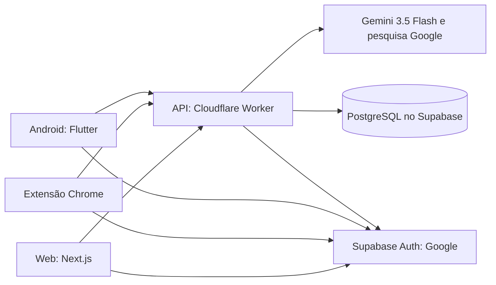

# Arquitetura — AutenticAI

## Objetivo e escopo

O AutenticAI é um projeto acadêmico de análise de informações. A API e a migração do banco estão em `system/backend/`. O projeto remoto do Supabase já tem o esquema inicial do histórico. Os clientes usam Supabase Auth com PKCE e enviam o token de acesso ao Worker. A extensão usa `activeTab` para ler o texto após solicitação. O Android usa `MediaProjection` para a captura iniciada pelo botão flutuante. [Guia do backend](../system/backend/README.md)

O Next.js também será hospedado na infraestrutura Cloudflare. O Worker recebe as requisições, valida a sessão, chama o Gemini e registra os resultados no Supabase. A resposta é enviada diretamente ao cliente. A chave do Gemini fica somente no servidor, como segredo do Worker.

## Fluxo de análise

1. O usuário entra com sua conta Google e seleciona o conteúdo na web, na extensão ou no Android.
2. O cliente mostra uma prévia e pede confirmação antes do envio. Web e Android aceitam texto digitado ou print escolhido. O Android também aceita um print capturado com autorização, e a extensão extrai texto da página ativa.
3. O Worker valida a sessão e a entrada e envia o conteúdo à Gemini API com pesquisa Google habilitada. A configuração usa `gemini-3.5-flash`, que o Google redireciona para o 3.6 Flash. As fontes vêm dos metadados da pesquisa. [Notas da Gemini API](https://aistudio.google.com/docs/changelog#10-08-2026)
4. O resultado apresenta afirmações, justificativas e fontes disponíveis. Se a pesquisa falhar ou não houver evidências suficientes, informa a limitação ou apresenta resultado inconclusivo.
5. O histórico salva o texto enviado ou extraído da imagem, o resultado e as fontes, vinculados ao usuário. O print original não é armazenado permanentemente. Cada usuário pode consultar e excluir seus próprios registros.

O usuário vê o conteúdo que será enviado ao provedor de IA e confirma a operação. Dados enviados e resultados podem conter informações pessoais: o acesso ao histórico deve ser restrito ao dono, inclusive no banco de dados. Usar HTTPS, validar entradas e não registrar conteúdo sensível em logs. Cotas, custos e disponibilidade da pesquisa dependem do plano e das condições atuais do provedor.

O modelo de dados do histórico está no [diagrama entidade-relacionamento](DER.md).

## Android: botão flutuante e captura

O Flutter apresenta a interface; a integração nativa Android implementa a sobreposição e a captura. As permissões são diferentes: **aparecer sobre outros apps** permite mostrar o botão flutuante, mas não autoriza ler a tela.

1. O usuário habilita a sobreposição nas configurações do Android e toca no botão flutuante para iniciar uma análise.
2. O aplicativo solicita o consentimento de captura com `MediaProjection`. O Android exige novo consentimento para cada sessão de captura; não há captura silenciosa.
3. Após o consentimento, a integração usa um serviço em primeiro plano do tipo `mediaProjection`, com as declarações exigidas pela versão do Android. Captura uma imagem, encerra a sessão e exibe a prévia para confirmação.
4. Se o usuário negar uma permissão ou a tela estiver protegida, o app explica o impedimento e não envia conteúdo. Algumas telas protegidas podem aparecer vazias ou não ser capturáveis.

A captura não fica ativa continuamente. Detalhes e requisitos variam com a versão e o SDK alvo: [MediaProjection — Android Developers](https://developer.android.com/media/grow/media-projection).

## Resultado e níveis de análise

A verificação factual e os indícios de conteúdo gerado por IA aparecem em seções separadas. O Gemini pode descrever sinais observados, mas não é um detector de autoria validado: não apresentar porcentagem, certeza ou ausência de sinais como prova de origem humana.

| Nível | Situação | Ideia para profundidade, tempo e custo |
|---|---|---|
| **Light (Leve)** | Nível da API, configurado com Gemini 3.5 Flash | Análise inicial com pesquisa de fontes. |
| **Médio** | Visão futura | Investigação mais ampla que a Light. |
| **Alto** | Visão futura | Investigação mais aprofundada, com maior tempo e custo. |
| **Ultra** | Visão futura | Investigação mais extensa, com maior tempo e custo previstos. |

Os níveis futuros não têm modelos ou recursos contratados e não garantem maior veracidade. Em todos os casos, a conclusão depende das evidências encontradas.

## Referências técnicas

- [Captura de tela no Android](https://developer.android.com/media/grow/media-projection)
- [Pesquisa Google com Gemini](https://ai.google.dev/gemini-api/docs/google-search)
- [Next.js na Cloudflare](https://developers.cloudflare.com/workers/framework-guides/web-apps/nextjs/)
- [Login Google no Supabase](https://supabase.com/docs/guides/auth/social-login/auth-google)
