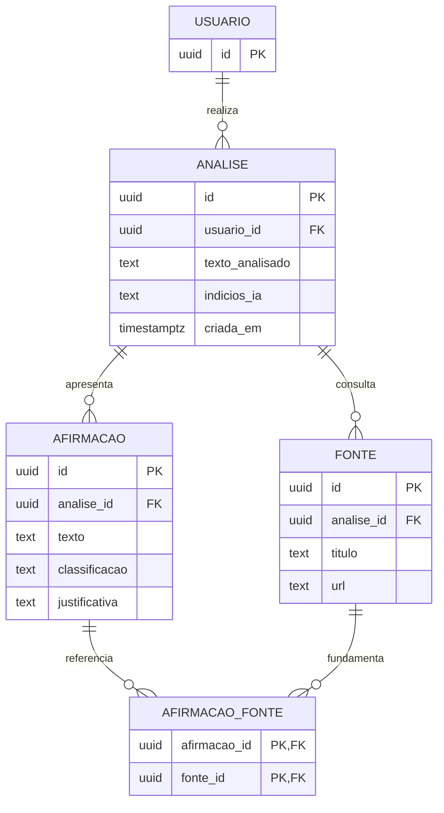

# Diagrama entidade-relacionamento — AutenticAI

Este é o modelo de dados previsto para o histórico de análises no PostgreSQL do Supabase. O usuário e sua autenticação são gerenciados pelo **Supabase Auth**, com login Google.

## Como ler o modelo

- **Usuário:** identificado pelo ID de `auth.users` do Supabase. Um usuário pode realizar várias análises.
- **Análise:** guarda o texto enviado ou extraído da imagem, os indícios de IA e a data. Indícios de IA são uma descrição, não uma confirmação de autoria.
- **Afirmação:** registra o texto identificado, sua classificação e justificativa. Uma análise pode ter várias afirmações.
- **Fonte:** registra título e endereço de uma fonte retornada para a análise. Uma afirmação pode usar várias fontes, e uma fonte pode fundamentar várias afirmações da mesma análise; a tabela de ligação registra essas relações.

Cada usuário pode consultar e excluir apenas suas próprias análises. A exclusão de uma análise também remove suas afirmações, fontes e vínculos. As permissões no banco devem proteger as tabelas relacionadas pelo dono da análise e impedir vínculos entre análises diferentes.

O texto extraído de um print pode ser salvo no histórico; a imagem original não é armazenada permanentemente. Uma análise pode não ter afirmações, fontes ou indícios de IA quando não houver conteúdo ou evidências suficientes.
