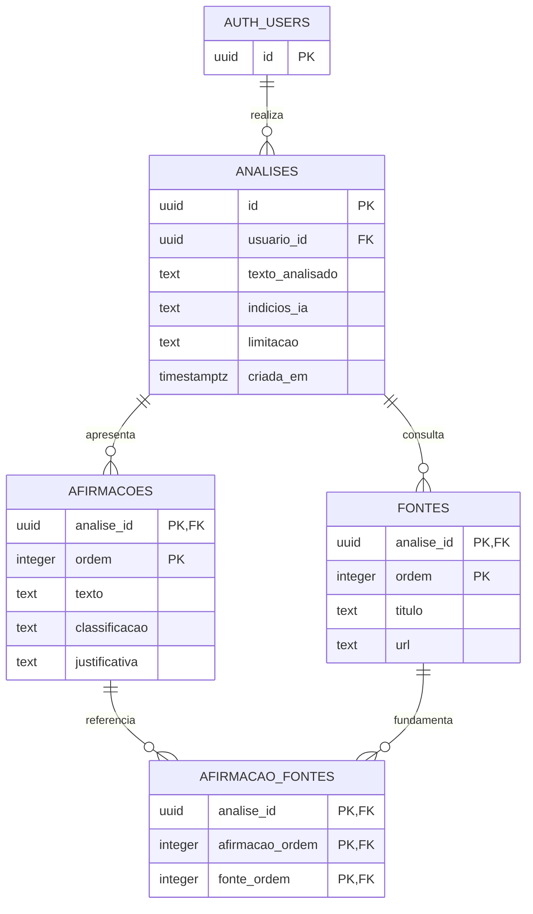

# Diagrama entidade-relacionamento — AutenticAI

Este é o modelo do histórico. A tabela de usuários pertence ao Supabase Auth, com acesso por Google ou e-mail e senha. [Migração SQL](../system/backend/supabase/migrations/20261119000000_historico.sql)

## Como ler o modelo

- **Usuário:** identificado pelo ID de `auth.users` do Supabase. Um usuário pode realizar várias análises.
- **Análise:** guarda o texto enviado ou extraído da imagem, os indícios de IA e a data. Indícios de IA são uma descrição, não uma confirmação de autoria.
- **Afirmação:** registra o texto identificado, sua classificação e justificativa. Uma análise pode ter várias afirmações.
- **Fonte:** registra título e endereço de uma fonte retornada para a análise. Uma afirmação pode usar várias fontes, e uma fonte pode fundamentar várias afirmações da mesma análise; a tabela de ligação registra essas relações.

As políticas do banco restringem o histórico ao dono. A exclusão de uma análise remove suas afirmações, fontes e vínculos. A chave composta vincula afirmações e fontes somente dentro da mesma análise.

O texto extraído de um print pode ser salvo no histórico; a imagem original não é armazenada permanentemente. Uma análise pode não ter afirmações, fontes ou indícios de IA quando não houver conteúdo ou evidências suficientes.
