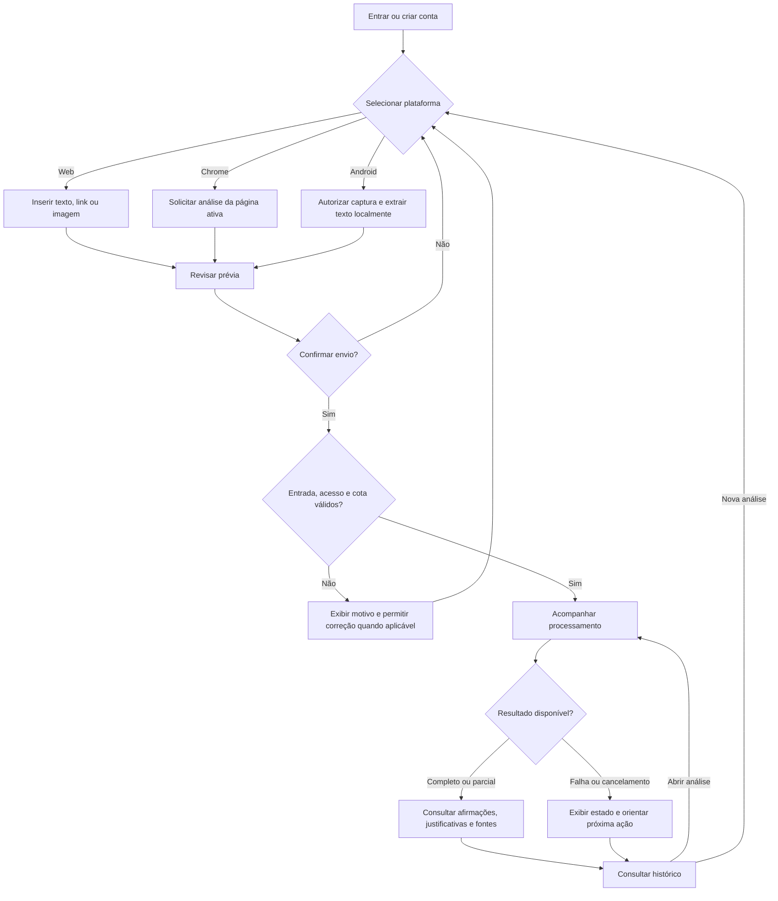
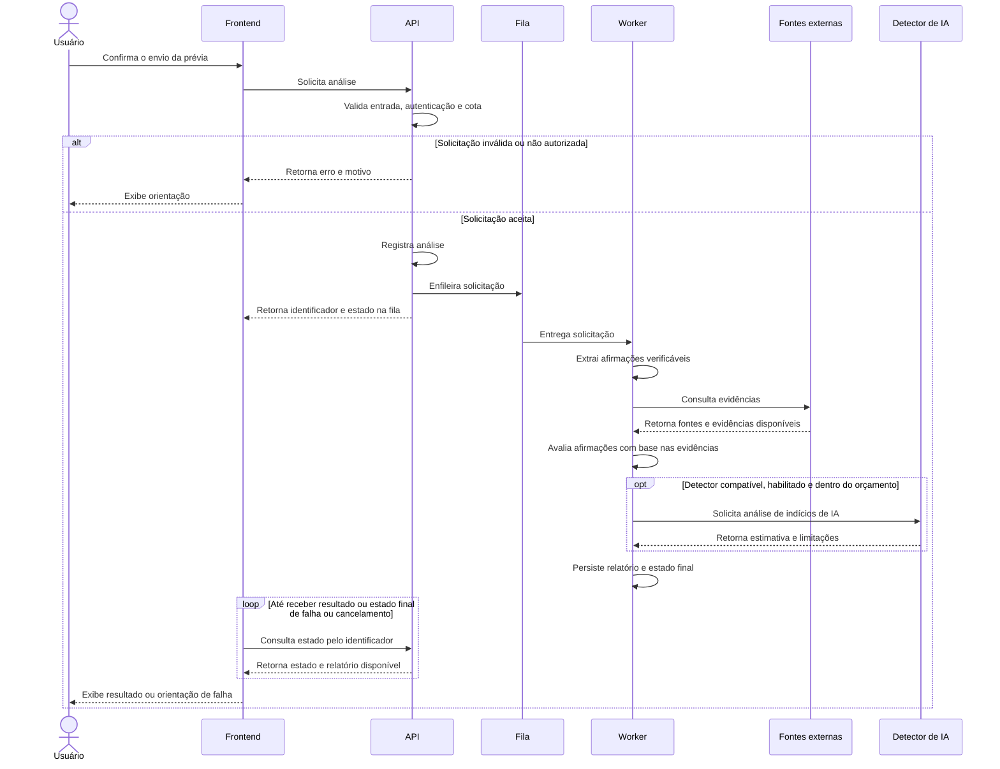

# Documentação de Requisitos e Prototipagem Inicial — AutenticAI

## Objetivo

Definir o fluxo de uso e a estrutura das principais telas para orientar o desenvolvimento frontend. Os wireframes são esboços de baixa fidelidade: representam conteúdo, hierarquia e ações, sem definir o acabamento visual. Aplicar os estilos da [Identidade Visual](IDENTIDADE_VISUAL.md) na implementação.

O sistema está em planejamento. Os exemplos abaixo são ilustrativos e não representam análises realizadas.

## Fluxo do sistema

### Processamento da solicitação

O cliente consulta o estado periodicamente enquanto a análise está em andamento. A análise de indícios de IA é independente da verificação factual. O diagrama representa o processamento esperado; falhas devem seguir os estados e tratamentos definidos neste documento.

| Plataforma | Entrada e autorização | Continuação do fluxo |
|---|---|---|
| Web | Texto digitado, link HTTP(S) ou imagem selecionada pelo usuário | Prévia, confirmação e envio à API |
| Chrome | Clique em “Analisar página” para extrair texto da aba ativa compatível | Prévia e confirmação antes do envio |
| Android | Toque em “Analisar tela”, consentimento do sistema e captura pontual | OCR local, revisão do texto extraído e envio somente do texto selecionado por padrão |

Na web, a prévia de um link apresenta a URL informada; a extração do conteúdo remoto ocorre no servidor após a confirmação. No Android, encerrar a captura após obter o conteúdo necessário. Nenhuma plataforma deve realizar monitoramento contínuo.

## Requisitos associados às telas

| ID | Requisito | Tela |
|---|---|---|
| RF01 | Criar conta, entrar, recuperar acesso e encerrar sessão | Acesso e navegação |
| RF02 | Selecionar texto, link ou imagem para análise | Nova análise |
| RF03 | Revisar conteúdo e autorizar envio, incluindo página e tela | Prévia |
| RF04 | Acompanhar o estado da solicitação | Processamento |
| RF05 | Consultar classificação, justificativa e fontes por afirmação; separar indícios de IA | Resultado |
| RF06 | Consultar análises anteriores e excluir registros próprios | Histórico |

## Estados e tratamento de falhas

| Situação | Comportamento da interface |
|---|---|
| `queued` / `processing` | Exibir “Na fila” / “Processando” e permitir acompanhar pelo histórico |
| `completed` / `partial` | Exibir relatório completo / parcial, identificando limitações |
| `failed` / `cancelled` | Informar falha / cancelamento; oferecer nova análise quando aplicável |
| Conteúdo sem afirmações verificáveis | Explicar a ausência de afirmações; não forçar uma classificação factual |
| Permissão negada ou página/tela protegida | Explicar a restrição e permitir retornar sem enviar conteúdo |
| Limite de uso atingido | Informar o bloqueio e a disponibilidade de nova tentativa, se conhecida |
| Falha de conexão | Preservar a entrada na tela; se já houver solicitação, consultar seu estado antes de reenviar |
