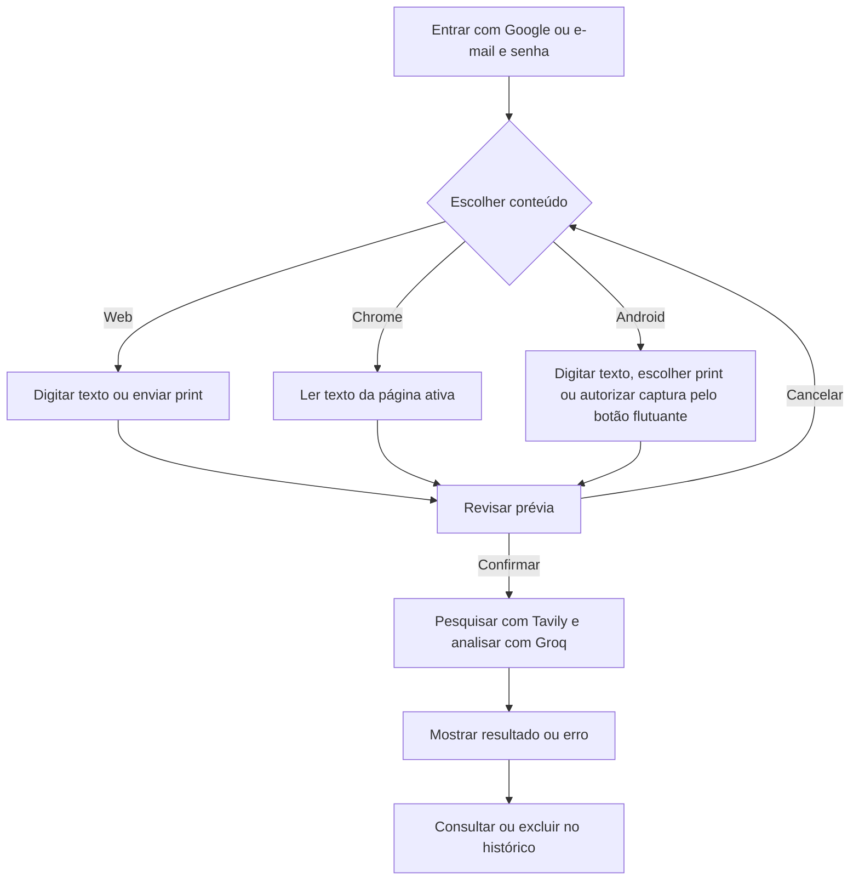

# Fluxos e prototipagem — AutenticAI

## Objetivo

Este documento orienta as telas do projeto acadêmico. Os fluxos são planejados; o [protótipo visual existente](../prototype/README.md) é demonstrativo e não realiza análises reais. Para cores e componentes, consulte a [identidade visual](IDENTIDADE_VISUAL.md).

## Fluxo principal

A prévia informa que o conteúdo será enviado ao serviço de IA. A análise é iniciada somente após confirmação. No Android, a sobreposição e a captura exigem autorizações distintas; após uma captura, a sessão é encerrada. Detalhes em [Arquitetura](ARQUITETURA.md).

## Telas principais

| Tela | Conteúdo e ações |
|---|---|
| **Acesso** | Entrar com Google ou e-mail e senha, criar conta, confirmar o e-mail com um código e encerrar a sessão. |
| **Nova análise** | Na web e no Android, digitar texto ou escolher print. No Android, também iniciar captura pelo botão flutuante. Na extensão, ler a aba ativa. |
| **Prévia** | Mostrar o texto ou a imagem que será enviada, informar o uso de IA e permitir confirmar ou cancelar. |
| **Resultado** | Mostrar afirmações, classificação, justificativas e fontes disponíveis. Apresentar indícios de IA separadamente, sem percentual ou garantia de autoria. |
| **Histórico** | Consultar e excluir as próprias análises; mostrar texto, resultado e fontes, sem guardar o print original. |

## Estados e falhas

- **Processando:** indicar que a análise está em andamento, sem prometer tempo de resposta.
- **Inconclusivo:** explicar quando não houver evidências suficientes ou fontes disponíveis.
- **Falha de análise ou conexão:** informar o problema e permitir nova tentativa, preservando a entrada quando possível.
- **Permissão negada ou tela protegida:** explicar a restrição; não capturar nem enviar conteúdo sem autorização.
- **Sem texto verificável:** informar que não foram encontradas afirmações analisáveis, sem inventar uma classificação.

O protótipo atual inclui uma opção de link e resultados fictícios da interface anterior. Os fluxos acima definem as entradas do projeto.
